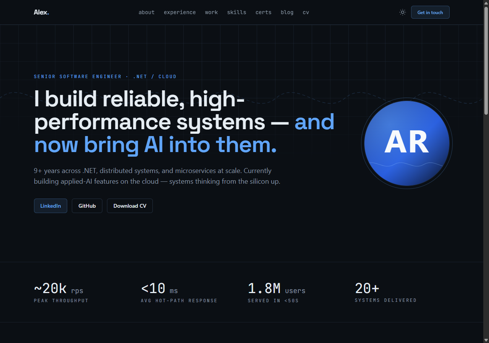
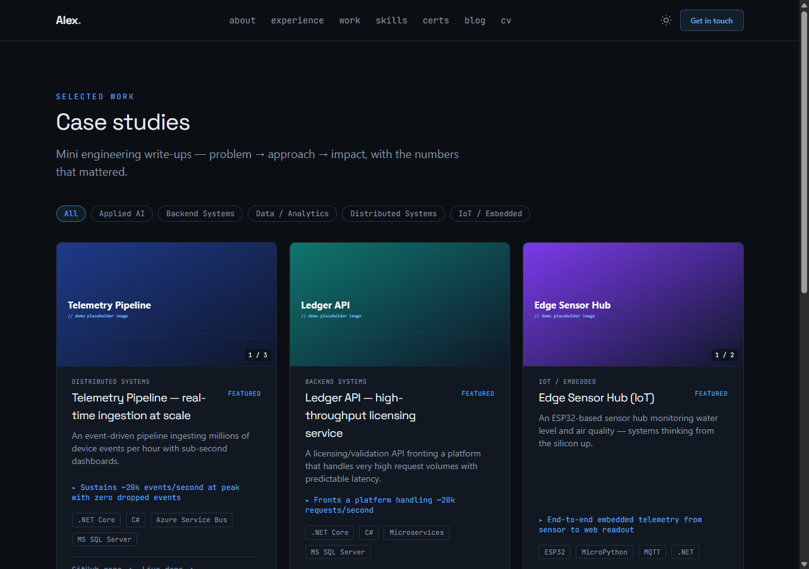

# Living CV — a database-backed portfolio template

A **portfolio & living-CV** web app built with ASP.NET Core Razor Pages, designed to double as
proof of the skills it describes. Content lives in the database (seeded from JSON) and identity
lives in configuration — so you can make it your own **without touching the code**.

It ships with a **fictional demo persona ("Alex Rivera")** so every feature is populated and
testable the moment you run it. Swap in your own details to make it yours.

<p align="center">
  
  
</p>

<p align="center">
  <a href="LICENSE"></a>
  
  
  <a href="https://github.com/hamzaultimate/living-cv/actions/workflows/ci.yml"></a>
  <a href="CONTRIBUTING.md"></a>
</p>

## Features

- Server-rendered **Razor Pages** (SEO-first) with a light/dark theme toggle
- Pages: Home, About, Experience, **Work** (case studies with image galleries + lightbox),
  Skills, **Certifications** (badge grid + branded issuer cards), **Blog** (Markdown, drafts,
  share buttons), Talks (YouTube embeds), **CV** (HTML + generated **PDF**), Contact
- **CV ATS-readiness badge** — 8 deterministic checks (contact info, quantified impact, date
  consistency, etc.) scored offline by a console tool, no runtime API calls or keys
- `og.png` share image, `sitemap.xml`, `robots.txt`, and schema.org JSON-LD (`Person`,
  `WebSite`, `BreadcrumbList`, `CreativeWork`, `BlogPosting`) — all generated
- Optional **GA4 analytics** via `Site.GoogleAnalyticsId` — omitted entirely when unset, and
  auto-disabled on `dev.*` subdomains so local/dev traffic never reaches production analytics
- **Seed-if-empty JSON seeder** — each table is filled from its seed file only when it has no
  rows; existing rows are never updated or deleted. Set `Seed:Mode=Authoritative` to make the
  seed files the source of truth instead (rows are added / updated / removed to match)
- **Owner admin** at `/admin`: one-time `/setup` (gated by a `Setup:Key`) creates the single owner account;
  cookie sign-in with lockout, a profile editor, and photo upload (re-encoded, metadata stripped,
  stored outside `wwwroot`). See [docs/new-user-guide.md](docs/new-user-guide.md#3-claim-the-site-and-use-the-admin)
- **Profession templates** with a live preview switcher at `/admin/template`. Two ship today:
  **Software & IT** (case-study showcase, the original look) and **Healthcare** (credentials-first
  layout, calm theme, guidance against publishing patient data, fictional starter content). A template
  sets the wording, section list and theme; switching hides sections the template does not use and
  never deletes content. See [docs/template-authoring-guide.md](docs/template-authoring-guide.md)
- **Setup wizard** at `/admin/welcome`, opened right after `/setup` and re-runnable from the dashboard: pick a
  template (cards with thumbnail and what is included), enter your basics (title and summary are suggested by the
  template), optionally add a photo, then review a live draft preview, choose an accent colour and starter content
  (blank, or fictional sample entries) and publish. Progress is saved per step, nothing is public until you publish,
  and a fresh database goes to a live site without editing any config file.
- Health checks at `/health` (liveness) and `/health/db` (DB readiness)
- Zero front-end build dependencies to *run* it (Tailwind is compiled during build)

## Tech stack

| Concern | Choice |
|---|---|
| Web | ASP.NET Core **Razor Pages**, server-rendered |
| Runtime | **.NET 10 (LTS)**, publishable self-contained |
| Data | **SQL Server** via EF Core (LocalDB for local dev) |
| Styling | Tailwind CSS |
| PDF CV | QuestPDF, generated from the same data as the site |
| CI | GitHub Actions (build validation on every PR) |

## Quick start

Requires the **.NET 10 SDK** and **SQL Server LocalDB** (ships with Visual Studio, or install
SQL Server Express). The local connection string is already set in
`src/Portfolio.Web/appsettings.Development.json` and points at `(localdb)\MSSQLLocalDB`.

```bash
dotnet restore
dotnet run --project src/Portfolio.Web
```

On first run the app **applies EF Core migrations and seeds the demo content automatically**
(except on a new install with a `Setup:Key`, where the setup wizard decides: see the
[new user guide](docs/new-user-guide.md#3-claim-the-site-and-use-the-admin)).
It launches over HTTPS by default, so open the printed `https://localhost:7239` URL (or the generated local HTTPS port). Health check: `/health`.

> No database configured? The site still runs — DB-backed pages show empty states and
> `/health/db` reports the status.

For a fuller walkthrough, see [docs/new-user-guide.md](docs/new-user-guide.md).

## Make it yours

Everything personal lives in two places — **no code changes required**:

1. **Identity & copy** → the `"Site"` section of `src/Portfolio.Web/appsettings.json`
   (name, role, hero text, metrics, About narrative, contact links, `PhotoUrl`). These values are
   the defaults: on first run with a database they are copied into a profile row, which is read
   from then on (without a database the config values are used directly).
2. **Content** → the JSON files in `src/Portfolio.Data/Seed/`
   (`projects`, `experiences`, `skills`, `certifications`, `talks`, `blog`, `testimonials`).
   Each file has a header comment describing its shape. They seed an empty database; to re-apply
   edited files to a populated one, set `Seed:Mode=Authoritative` (or clear the tables).

After the first run you can also edit the profile and upload your photo in the browser at `/admin`
(see [Claim the site](docs/new-user-guide.md#3-claim-the-site-and-use-the-admin)); the database then
holds your edits and `Site` is only the starting point. Uploaded photos are stored in `Uploads:Path`
(default `App_Data/uploads`), which must be a persistent folder that your deploy does not replace.

Otherwise, add images under `src/Portfolio.Web/wwwroot/img/` and set `Site:PhotoUrl`.

To enable GA4 analytics, set `Site:GoogleAnalyticsId` to your Measurement ID (`G-XXXXXXXXXX`);
leave it blank to ship with no analytics script at all. See
[docs/seo-analytics.md](docs/seo-analytics.md) for how structured data and analytics are wired up.

The `/cv` page's ATS score badge is generated offline, not on every request — after editing CV
content, regenerate it with `dotnet run --project tools/CvAtsReview` and commit the updated
`ats-report.json`. See [docs/cv-ats-scoring.md](docs/cv-ats-scoring.md) for how the scoring works.

## Build & publish

```bash
dotnet publish src/Portfolio.Web/Portfolio.Web.csproj -c Release \
  -r win-x64 --self-contained true -o ./publish
```

Set the production database via the `ConnectionStrings__Default` environment variable (or
`appsettings.Production.json`). **Never commit real credentials.**

To create the owner account on a fresh deployment, also set `Setup__Key` (a long random value, server
side only) and open `/setup` once. Keep `Uploads:Path` on a persistent folder. Details in the
[new user guide](docs/new-user-guide.md#3-claim-the-site-and-use-the-admin).

## Project structure

```
src/Portfolio.Web/                ASP.NET Core Razor Pages app
  Configuration/SiteOptions.cs    Bound identity/content config ("Site" section)
  Pages/                          Razor Pages (Pages/Admin is the owner area, Pages/Admin/Welcome the setup wizard, Pages/Setup.cshtml the one-time setup)
  Templates/<key>/template.json   Profession templates (manifest, optional starter.json, preview.png thumbnail); template.schema.json documents the shape
  Styles/themes/<key>.css         Per-template theme variables, compiled into app.css
  Security/                       Owner account, cookie sign-in, setup key gate, reset-owner command
  Uploads/                        Image processing (SkiaSharp re-encode) and upload storage
  appsettings.json                Default site identity and public content
src/Portfolio.Data/               EF Core entities, migrations, and JSON seed data
  Seed/                           Seed content (edit these to change the site)
  Seed/ats-report.json            Generated CV ATS-readiness report (see docs/cv-ats-scoring.md)
  Seeding/PortfolioSeeder.cs      Seeder (seed-if-empty, or authoritative upsert-by-natural-key)
tests/Portfolio.Web.Tests/        Unit tests
tools/CvAtsReview/                Offline console tool that regenerates ats-report.json
docs/                             Notes, design system, and onboarding guides
```

## Contributing

Contributions are welcome! Please read [CONTRIBUTING.md](CONTRIBUTING.md) for the setup,
branching model, and coding conventions, and our [Code of Conduct](CODE_OF_CONDUCT.md).
Good first issues are labelled [`good first issue`](../../labels/good%20first%20issue).

## License

[MIT](LICENSE) — free to use, fork, and adapt.

## Maintainer

Built and maintained by [**@hamzaultimate**](https://github.com/hamzaultimate).
If this project helps you, a ⭐ is appreciated!
