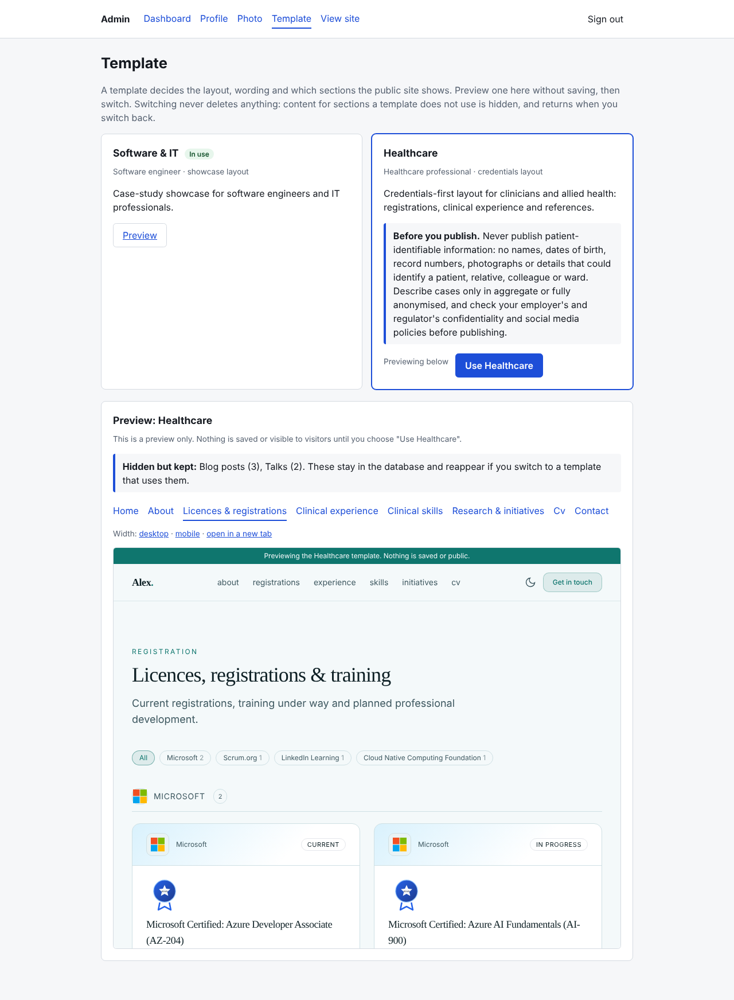

# New user guide

This guide is for anyone who wants to run the portfolio site locally, personalize it, and understand how the project is organized.

## 1. Prerequisites

The project is built with .NET 10 and SQL Server.

- .NET 10 SDK
- SQL Server LocalDB (recommended on Windows) or SQL Server Express
- A terminal and a code editor such as Visual Studio Code or Visual Studio

If you are using Windows, the default local configuration already points to LocalDB, so the quickest path is usually to install the SQL Server Express/LocalDB tooling and run the app as-is.

## 2. Run the app locally

From the repository root:

```bash
dotnet restore
dotnet run --project src/Portfolio.Web
```

The first run will:

- apply EF Core migrations
- seed the demo content into any empty table (existing rows are never changed). The one exception is a new
  install that can still be claimed (a `Setup:Key` is set and the setup wizard is not finished): there the demo
  content waits for the wizard, so "start blank" really is blank (see "First run" below)
- launch over HTTPS by default at a local URL such as `https://localhost:7239`

Open the printed URL in your browser. The app also exposes health endpoints at:

- `/health` for liveness
- `/health/db` for database readiness

> If you do not have a database configured yet, the site can still start, but database-backed pages may show empty states until you provide a valid connection string.

## 3. Claim the site and use the admin

A fresh deployment has no owner. The first person with the **setup key** claims it; after that
`/setup` returns 404 for good. There is exactly one account: no sign-up, no second user, no roles
(the database itself refuses a second account row).

### First run

1. Choose a long random value (16+ characters) as the setup key and give it to the app **on the
   server only**, for example as an environment variable (`Setup__Key`) or in an
   `appsettings.Production.json` that is not committed. The `Setup:Key` entry in
   `appsettings.json` is intentionally empty: empty or shorter than 16 characters means `/setup` is
   disabled.
2. Start the app and open `/setup`. Enter the key, pick a user name and a password (12 to 128
   characters) and submit. Wrong keys are throttled: after 5 wrong guesses `/setup` refuses everything,
   even the right key, for 15 minutes. That count is kept in the app's memory, shared by all visitors, so
   restarting the app clears it; it is a brake on guessing, not a permanent lock.
3. You are sent to the sign-in page and, once signed in, straight into the **setup wizard** (see below).
   Afterwards, from `/admin` you can edit the profile (`/admin/profile`) and the
   photo (`/admin/photo`). Saving a profile takes effect immediately, including the CV PDF, the
   share image and the sitemap.
4. Remove `Setup__Key` from the server when you are done; it has no further use.

### The setup wizard

The wizard at `/admin/welcome` takes about two minutes and needs no config file edits. Every step is saved as you
go, so a refresh, a sign-out or a new browser picks up where you left off. **Nothing is public until you press
Publish**: the draft is stored apart from the live profile, and the public pages, sitemap, CV PDF and share image keep
showing the placeholder site meanwhile.

1. **Template.** Cards grouped by profession show a thumbnail, the pages the template has, what a piece of work is
   called, whether sample content is available and any guidance (Healthcare reminds you never to publish patient data).
2. **Basics.** Name, professional title, email, location (optional) and a short summary. Title and summary start
   from the template's suggestion; they are published as written, so edit them.
3. **Photo.** Optional. The photo goes through the same checks as the Photo page (JPEG, PNG or WebP, re-encoded,
   metadata removed) and is kept in a private area until you publish. There is no cropping step: the site shows
   the photo as a circle centred on the picture. Without a photo your initials are shown.
4. **Review and launch.** A live preview of your draft (owner-only, never indexed or cached, no analytics), the
   address your site will use, an accent colour from the template's list, and starting content: **blank**, or **sample
   content** (fictional entries so you can see a full site). Press **Publish my site**.

Publishing applies everything in one transaction and refreshes the sitemap, CV and share image at once. Pressing it
twice, or replaying the request, changes nothing the second time.

On the first run, publishing replaces the placeholder profile that came from the `Site` section of
`appsettings.json` (hero text, metrics, About text, links, phone) with your answers: those parts stay empty until you
fill them in `/admin/profile`. If you edited the `Site` section before the first run and want to keep those values,
choose **Skip setup** instead. Skipping keeps the placeholder profile exactly as it is and loads the demo content into
any empty table, which is what a new install did before the wizard existed.

**Sample content never overwrites or deletes anything.** It is added only to tables that have no rows at all; a table
that already has content is left exactly as it is, and the review step says which ones. For Software & IT the sample
is the built-in demo persona (the seed files); for Healthcare it is the template's fictional `starter.json`. Sample
rows come without the sample persona's profile text: your name, title and summary are always your own.

Run the wizard again any time from the dashboard (**Setup wizard**). A re-run starts from what the site says now,
changes only the template, your basics, address, accent colour and photo, and never touches your hero, About text,
metrics or content rows. A site that existed before the wizard was added counts as already set up and is not sent
into it; an unfinished wizard only shows a prompt on the dashboard and never blocks any other admin page.

Sign-in locks for 15 minutes after 5 consecutive failures (any user name counts, because there is
only one account). Sessions last 30 minutes of inactivity and 12 hours at most; signing out also ends
the account's other sessions.

Because that lockout is shared, a stranger could fail on purpose to keep you out. Two things prevent
that. First, each client address may make only 10 sign-in attempts per 15 minutes, counted before the
account lockout or the password check, so one address cannot burn through the account's allowance.
Second, once you have signed in from a browser, it keeps a signed `lcv-device` cookie (one year,
`HttpOnly`, `Secure`, `SameSite=Strict`) and that browser is not stopped by the lockout: it still has
to supply the right password. A browser without the cookie, such as a new device, waits out the
15 minutes or uses `reset-owner`. Resetting the password invalidates the cookie everywhere, and so does
anything that changes the stored password hash, such as an automatic rehash when the hashing settings
are upgraded at a later sign-in. A browser holding the cookie also gets its own sign-in allowance,
separate from its address, so someone sharing the owner's address cannot use it up.

The per-address limit uses the address the server sees. Directly on IIS (in-process) that is the
visitor's real address. Behind any other reverse proxy or load balancer, every visitor appears to come
from the proxy unless forwarded headers are configured for it (see the note below), and the limit then
applies to all visitors together.

> The site must be served over HTTPS outside Development: the sign-in, anti-forgery and flash cookies
> are `Secure` and the app refuses to issue them on plain HTTP. Behind a TLS-terminating reverse
> proxy (anything other than IIS/ANCM), set `ASPNETCORE_FORWARDEDHEADERS_ENABLED=true` so the app
> sees the original `https` scheme and client address. That setting trusts the forwarded headers from
> any sender, so only use it when the app can be reached through the proxy alone, and only behind a
> proxy that appends to or overwrites `X-Forwarded-For`. A proxy that passes the header through lets an
> attacker send a different value on every request and get a fresh per-address allowance each time.

### Forgot the password

There is no email reset. Whoever can run commands on the server resets it from the app folder:

```bash
dotnet run --project src/Portfolio.Web -- reset-owner        # development checkout
dotnet Portfolio.Web.dll reset-owner                         # published app (Portfolio.Web.exe on Windows)
```

It prompts twice for the new password without echoing it, then clears any lockout, signs out all
existing sessions and trusted browsers, and prints the account's user name, which covers a forgotten
name too. For scripts, pipe the password with `--password-stdin` or set
`OWNER_NEW_PASSWORD` for that one command (and unset it afterwards). The command talks to the
database, prints a result and exits; it never starts the web server.

The command reads the connection string from the same configuration as the site, in the shell you run
it from. On IIS the site's `ConnectionStrings__Default` usually lives in the site's environment or
application settings, which a command prompt does not have: set `ConnectionStrings__Default` in that
shell first (for example `$env:ConnectionStrings__Default = '...'` in PowerShell), or the command fails
with a message that the database is not configured.

### Uploaded photos and where they live

Photos are uploaded at `/admin/photo`: JPEG, PNG or WebP up to 5 MB (`Uploads:MaxBytes`). Each file
is decoded and re-encoded (so location and camera details are removed, rotation is applied, and
anything hidden inside the file is discarded), scaled to at most 1600 px on the long edge, saved under
a random name and served from `/uploads/<name>`. SVG, GIF and anything that is not a real raster
image is rejected.

Files are stored in `Uploads:Path`:

| Setting | Meaning |
|---|---|
| empty (default) | `App_Data/uploads` under the app folder: outside `wwwroot` and never served as a static asset |
| relative path | resolved against the app folder |
| absolute path | used as is (for example `D:\data\portfolio-uploads` or `/var/lib/portfolio/uploads`) |

**Deploying:** the folder must survive deployments. The bundled pipeline uploads over FTPS without
clearing the target, so the default survives it, but any deploy that replaces the whole site folder
(a "clean" upload, a container image, a new slot) will delete the photo. In that case set
`Uploads__Path` to a persistent location outside the deployed folder, and back that folder up.
The process needs write access to it. The profile stores only the `/uploads/...` URL, so restoring
the folder restores the photos.

Sign-in cookies and anti-forgery tokens are encrypted with ASP.NET Core Data Protection keys. If the
host does not keep those keys across restarts you will simply be asked to sign in again; configure a
persistent key location if that matters to you. The trusted-browser cookie depends on the same keys: if
they are lost on every restart or recycle (IIS without a loaded user profile, containers without a
mounted volume), trusted browsers stop working and the lockout protection above silently goes away
(it fails closed, so nobody gets in who should not, but the owner can be locked out again).

On IIS, enable "Load User Profile" for the application pool so the default key folder is kept. Elsewhere
the app has no setting for this, so add one line to `src/Portfolio.Web/Program.cs`, pointing at a folder
that survives restarts (a mounted volume in a container):

```csharp
builder.Services.AddDataProtection().PersistKeysToFileSystem(new DirectoryInfo("/var/lib/living-cv/keys"));
```

Keep that folder private: anyone who can read the keys can forge the cookies.

## 4. Personalize the site


The app is designed so you can make it your own without editing code.

### Identity and copy

Edit the `Site` section in [src/Portfolio.Web/appsettings.json](../src/Portfolio.Web/appsettings.json) to change:

- your name and role
- the hero copy and summary
- links such as GitHub, LinkedIn, and email
- the profile photo URL

These values are the defaults for the site profile. With a database, they are copied into a profile row on first run and that row is used afterwards; edit the `Site` section before the first run, or set `Seed:Mode=Authoritative` to re-apply it on every start. Be careful with that second option once you use `/admin`: Authoritative overwrites the stored profile from the config on the first read after each start, which discards edits made in `/admin/profile`, and it replaces the photo URL, leaving an uploaded photo file in the uploads folder with nothing pointing at it. Once you have an owner account you can change all of these in the browser at `/admin/profile` instead.

### Template

The wizard's first step picks the template; to change it later without running the wizard, go to `/admin/template`, where you pick the template that suits your profession: **Software & IT** or **Healthcare**.
Choose a card, press Preview, and the public site is shown inside the page in that template's layout, wording and
colours, with tabs for each page and a mobile width. Nothing is saved until you press "Use ...". Switching never
deletes content: sections the new template does not use (for example Blog posts under Healthcare) are hidden from the
navigation, sitemap and CV, their pages answer 404, and everything returns if you switch back. The page shows what
stays hidden but kept. Healthcare shows a reminder never to publish patient-identifiable information.

Previews only work while you are signed in as the owner; visitors and search engines never see them. The preview
address is `/?preview=<template key>` and is marked noindex.



### Content and pages

The seeded content lives in [src/Portfolio.Data/Seed](../src/Portfolio.Data/Seed). Each table is seeded only when it is empty, so editing a seed file does not change a database that already has rows. To apply edited seed files to an existing database, set `Seed:Mode` to `Authoritative` (for example `Seed__Mode=Authoritative` as an environment variable): then rows are added, updated, and removed to match the files on every start. Update those JSON files to change:

- projects
- experience entries
- skills
- certifications
- blog posts
- talks

### Images

Easiest: upload your photo at `/admin/photo` (see above). Alternatively add images under [src/Portfolio.Web/wwwroot/img](../src/Portfolio.Web/wwwroot/img) and point the `Site:PhotoUrl` setting to them. With no photo the home page shows a monogram of your initials.

### SEO and analytics

Every page ships schema.org JSON-LD (breadcrumbs, plus `Person`/`WebSite`/`CreativeWork`/`BlogPosting` where relevant) with no configuration needed. GA4 analytics is opt-in: set `Site:GoogleAnalyticsId` in `appsettings.json` to your Measurement ID to enable it, or leave it blank to omit the analytics script entirely. See [docs/seo-analytics.md](seo-analytics.md) for the full picture, including why the `dev.` subdomain never reaches production analytics.

## 5. Recommended development workflow

A typical contributor loop looks like this:

```bash
dotnet build
dotnet run --project src/Portfolio.Web
```

If you change the data model, create a migration:

```bash
dotnet ef migrations add <Name> --project src/Portfolio.Data --startup-project src/Portfolio.Web
```

If you change CV-relevant content (experience, projects, skills, certifications, or your `Site`
identity fields), regenerate the `/cv` page's ATS-readiness report so the badge stays in sync:

```bash
dotnet run --project tools/CvAtsReview
```

This writes `src/Portfolio.Data/Seed/ats-report.json`, which should be committed alongside your
content change. See [docs/cv-ats-scoring.md](cv-ats-scoring.md) for how the score is calculated.

## 6. Common issues

### LocalDB is not available

If the app cannot connect to the database, install SQL Server Express or LocalDB and try again. You can also update the connection string in [src/Portfolio.Web/appsettings.Development.json](../src/Portfolio.Web/appsettings.Development.json).

### HTTPS certificate warning

The app is configured to launch over HTTPS by default. If you see certificate issues when launching locally, run:

```bash
dotnet dev-certs https --trust
```

### The app starts but content is empty

That usually means the database was not initialized successfully. Check the `/health/db` endpoint and review the startup logs in the terminal.

## 7. Project layout

A quick map of the repository:

- [src/Portfolio.Web](../src/Portfolio.Web) — Razor Pages app, configuration, and static assets (`Pages/Admin` owner area, `Security` sign-in, `Uploads` image handling)
- [src/Portfolio.Data](../src/Portfolio.Data) — EF Core context, entities, and seed content
- [docs](../docs) — implementation notes and design documentation

For contribution guidance, see [CONTRIBUTING.md](../CONTRIBUTING.md).
